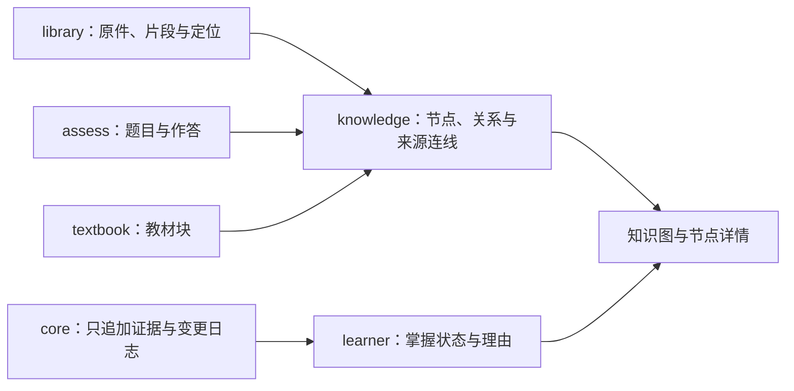

# 知识模型做深调研

> 2026-10-07 · 对应 PLAN 阶段 1 的 `knowledge` · 状态：调研完成；关系范围、A → B → C 和分阶段构图方向已确认，A、B、C 三批已实现并技术验收，待用户试用。10-16 补了图谱手感的调研（第 15 节），按它做了图谱改版。
> 依据：十月研究报告、[总体计划](../PLAN.md)、[已确认设计](design.md)、[契约](../stage0/contracts.md)，以及下文的一手研究、标准、官方文档和开源实现。

建议把 knowledge 做成能回答“这是什么、为什么这样学、依据在哪里、我的证据是什么”的知识网。先保证知识身份和关系可信，再把它画出来。继续保留四类节点、掌握层与来源层、全局共享、用户确认合并，以及 sigma.js；掌握推算仍归 learner。本文保留调研时的源码起点和建议；已采用的规则与当前能力以[设计文档](design.md)和[契约补充](../stage0/contracts.md#11-骨架阶段的补充10-03-搭骨架10-04-验收和协同修整)为准，B、C 的细节见设计文档。

## 1. 结论与实施建议

| 问题 | 建议 | 原因 |
|---|---|---|
| 节点多细 | 细到能改变诊断、反馈或教学决策；综合能力和完整任务仍需独立验证 | “能出一道题”只是最低条件；越碎不一定越有用 |
| 同名是否复用 | ID 决定身份；标题和别名用于查找、推荐候选；跨课程复用或合并由用户确认 | 同名可能异义，近义也可能要求不同表现 |
| 先修如何成立 | 关系保存理由、出处、适用课程或任务条件；只让有依据且适用的硬先修进入执行子图 | 章节顺序和模型常识都不足以证明必要性 |
| 如何构图 | 老师读资料后分小批建立草案，代码检查端点、出处、重复、环和版本 | 格式正确和语义正确要分别检查 |
| 图怎样有用 | 全局图用于浏览；课程图用于定位；节点详情把关系、原文和作答连起来；保留同等能力的列表 | 用户应能完成具体任务，而不仅是观看布局 |
| 合并怎样安全 | 旧节点、关系和证据保留；合并是一条可撤销的身份映射；learner 解释适用条件 | 不能重写历史，也不能取两个状态里“更绿”的一个 |
| 用什么技术 | SQLite 持久化；Graphology 作视图和算法投影；sigma v3.0.3 作图；布局在 worker 中有限运行 | 延续现有底座，不引入第二套数据主人 |
| 怎么交付 | A 数据与修改 → B 图与详情 → C 合并与受控抽取 | 每批都能独立验收；合并依赖最小的 learner 协作 |

## 2. 当前代码实际做到哪里

本节是源码核对结果，不是新增功能的验收。起点无未提交改动；类型检查、132 个自动测试和构建通过，另有 2 个付费检索基准按配置跳过。验证范围见[兼容性记录](../stage0/compatibility.md#knowledge-做深调研的起点核对10-07codex)。

| 位置 | 已有能力 | 做深要处理的缺口 |
|---|---|---|
| [store.ts](../../packages/knowledge/src/store.ts) | 四张表存全局节点、关系、课程成员和来源连线；添加在事务内完成 | `resolve()` 找不到时按全局标题复用，不比较类型、描述和条件；课程成员只存角色与顺序 |
| [knowledge 契约](../../packages/contracts/src/schema/knowledge.ts) | 别名、`replacedBy`、关系出处、考试范围字段已有类型 | 合并与考试范围未接线；`NewEdge` 没有出处输入，添加关系时出处默认空数组 |
| [tools.ts](../../packages/knowledge/src/tools.ts) | 老师可批量添加节点和四类关系 | 没有修改、停用、合并与撤销入口；同名复用和“能单独出题”的说明需要重审 |
| [store.ts](../../packages/knowledge/src/store.ts) 的关系写入 | 检查端点属于本课，按端点与类型去重 | 自环被静默跳过；不检查先修环；相同关系不能积累不同出处与适用范围 |
| [store.ts](../../packages/knowledge/src/store.ts) 的来源写入 | 能存片段、题目、教材块三类目标 | 只做格式校验；不检查节点或目标是否存在，不记录来源连线的修改历史 |
| [教材单元](../../packages/textbook/src/index.ts) | 教材块按标题匹配节点并写 `explains` 连线 | 自动接线主要来自教材块；题目考查节点保存在 assess，不能假定来源层连线已齐 |
| [core 的变更服务](../../packages/core/src/store.ts) | 保存节点和关系的创建日志，提交后通知 | core 只回退课程文件；数据库结构须由 knowledge 自己回退。课程成员与来源连线尚无完整日志 |
| [client.tsx](../../packages/knowledge/src/client.tsx) | 课程列表、类型分组、状态图例、选中后提问 | 无全局入口、图、详情、来源叠加和搜索；状态读取失败被当作空结果，会显示成未探测 |
| [learner](../../packages/learner/src/index.ts) | 按原节点 ID 读取日志，推算全局状态 | 不解析合并映射，不区分跨课程的适用条件；仅设置 `replacedBy` 不会正确搬运状态 |
| [planner](../../packages/planner/src/index.ts) | 无节点时请老师搭图 | 没有执行先修边；“硬先修影响排课”目前是已确认方向，尚非骨架能力 |

另外，课程图查询会读取全局关系后再过滤端点。做深时应按端点与作用域查询；目前未测出性能瓶颈，不据此宣称需要重构数据库。

## 3. 学习科学：节点是可检查的能力主张

### 粒度应服务决策

十月报告 §4.1 建议：只有单独诊断或教学会改变决策时，才值得建立长期节点。它也明确区分知识、技能、综合能力和完整任务。我们应保留这个标准，而不是把教材每个名词都永久入图。

Learning Factors Analysis 用专家判断与学习交互数据修订技能划分，说明初版认知模型可被检验和改进；论文中的几何任务研究不能给本项目提供一个通用的“最佳节点大小”。我们借鉴其可修订思路，现阶段不拟合统计模型。[Cen、Koedinger、Junker，2006](https://pact.cs.cmu.edu/koedinger/pubs/Cen%2C%20Koedinger%20%26%20Junker06.pdf)

**本项目建议：** 每个节点能用一两句说清：对象是什么，要求解释还是操作，在什么条件下做到什么。技能名尽量含可观察动作。知识节点保留简短概念名，在说明里写理解要求；课程的具体测试蓝图仍归 curriculum，具体题目仍归 assess，knowledge 不再存一份量规。

下面是用于设计的合成例子，不是已经核对的化工原理知识图：

| 表达 | 处理方式 |
|---|---|
| “流体流动” | 可以作浏览分组；不能仅凭某个小题正确就说整章掌握 |
| “解释表压与绝对压的区别” | 可单独诊断的知识节点 |
| “选取两个截面并列出能量衡算” | 可观察的技能节点，条件要说明 |
| “独立分析一套管路输送方案” | 完整任务，需要自己的整合表现证据 |
| “代入某个已给出的常数” | 除非它稳定影响诊断，否则作为题目步骤，不强制长期建节点 |

**组成不传递掌握。** 会了所有子技能，不自动证明综合任务成功；完成综合任务，也不能在没有分项判分的情况下把所有子节点点绿。节点详情可以显示“组成项已有证据，整合表现待验证”，推算仍由 learner 负责。

### 关系应是一句有条件的主张

概念图研究强调连线文字与上下文：两个概念加上关系词才能表达有意义的命题，构图围绕一个焦点问题。我们借鉴“关系能读成一句话”，不把观看专家画出的图当作掌握证据。[Novak 与 Cañas，2008](https://cmap.ihmc.us/docs/theory-of-concept-maps.php)

十月报告 §4.3 同样提醒：某种教学方案中需要先学 A，不代表所有任务和工具条件下都需要 A。推荐先学、共同发展和概念相关都不应被当作硬先修；只有执行用的先修子图需要无环约束。

**本项目建议：** 要声明硬先修，至少能解释“在这类任务与条件下，缺少哪个能力会阻断什么表现”，并给出依据。只知道教材排在前面时，标为建议先学；无法支持关系时保留草案，不让它约束规划。未知掌握状态意味着需要诊断，不意味着永远禁止进入下一节。

## 4. 标准：借鉴身份、关系和出处的表示

| 来源 | 已核对事实 | 本项目怎样采用 |
|---|---|---|
| [CASE 1.1 规范](https://www.imsglobal.org/spec/case/v1p1) | 能力项用稳定标识引用；能力项、框架、关系与量规分开 | 保留 ID 和课程成员的分工；本批不做 CASE 导入导出或认证 |
| [CASE 1.1 信息模型](https://www.imsglobal.org/sites/default/files/spec/case/v1p1/information_model/caseservicev1p1_infomodelv1p0.html) §7.4.1 | `precedes` 表示时间或顺序，`replacedBy` 表示被替代，`isPartOf` 表示包含 | 不把 `precedes` 当必要先修；合并后旧身份保留 |
| [CASE 实施指南](https://standards.1edtech.org/case/guides/standards/v1p1/impl) | 1.1 支持以 `ext:` 开头的扩展关系；未知扩展不能凭空获得其语义 | 将来导出硬先修时明确扩展含义，不冒充标准内置关系 |
| [SKOS](https://www.w3.org/TR/skos-reference/) §5、§10 | 概念标识与首选名、别名分开；`closeMatch` 与 `exactMatch` 不同，前者不传递 | 标题相似只产生候选；A 近似 B、B 近似 C 不构成三者合并理由 |
| [PROV-O](https://www.w3.org/TR/prov-o/) | 区分实体、活动、归属以及派生、引用和修订关系 | 记录依据哪份资料快照、哪次操作提出或修改；本地仍用现有数据库和变更日志 |

这些标准帮助表示和交换数据，不能证明节点正确、先修必要或学习效果。无需为借鉴这些规则引入 RDF 存储、OWL 推理或另一套能力平台。

## 5. 开源研究与实现：哪些值得借鉴

| 项目 | 可借鉴的做法 | 对本项目的限制与建议 |
|---|---|---|
| [CaSS](https://github.com/cassproject/CASS)、[Assertion 文档](https://docs.cassproject.org/v1.4/dev/fundamentals/cass-objects/assertion/) | 能力框架与证据主张分离；主张带时间、水平和证据 | 借数据分工，不采用其概率、有效期或推断规则替代 learner |
| [CaSS 的旧版推算说明](https://docs.cassproject.org/v1.3/guide/assertion-processing/) | 明确能力等价可依框架情境而不同 | 这是版本标明的设计参考；不据此声称当前 SDK 已替我们实现条件迁移 |
| [K12-KGraph 论文，2026-05](https://arxiv.org/html/2605.09635v1)、[作者仓库](https://github.com/haolpku/K12-KGraph) | 教材按节处理、约束类型抽取、分层汇总；先修与分类子图检查环，领域人员复核 | 与 MinerU 资料流程接近，优先借流程和结构测试。其中国中小学领域、专家验证和模型成绩不能外推到化工原理；不导入它的教材或题库 |
| [KGGen 论文](https://arxiv.org/abs/2502.09956)、[实现](https://github.com/stair-lab/kg-gen) | 抽取、汇总、实体与关系聚类分步骤 | 聚类适合给候选，但自动聚成同一实体不符合用户确认合并的约定；其通用图质量基准不是教学先修验证 |
| [Neo4j GraphRAG builder](https://neo4j.com/docs/neo4j-graphrag-python/current/user_guide_kg_builder.html) | 按 schema 和连接模式指导抽取；实体消歧是独立阶段 | 名称、模糊和语义匹配都只作候选，不能直接替换能力节点；不增加 Neo4j 服务 |
| [Microsoft GraphRAG](https://microsoft.github.io/graphrag/index/overview/)、[仓库](https://github.com/microsoft/graphrag) | 实体抽取、关系、社区和摘要分开处理 | 用于资料检索的实体网与能力网用途不同。官方也提醒索引成本；现有 library 已负责混合检索，本单元不重建 GraphRAG |

**推荐的自建范围：** 在现有 TypeScript、Zod、SQLite 与 `complete()` 上实现小规模、可核对的知识结构操作。开源项目作为流程和反例参考，不整套嵌入。候选名称相似度先在本机算；只有需要解释差异时才调用模型，不为每个节点增建一次在线向量索引。

## 6. 数据建议：全局身份与课程适用范围

### 数据归属

箭头表示服务读取或登记，不表示数据复制。所有单元继续只依赖 contracts。作答照片、题目正文和资料原文不复制进 knowledge 的表。

### 最小补充方向

| 对象 | 建议补齐 | 仍由谁负责 |
|---|---|---|
| 知识节点 | 稳定的含义与边界、适用领域、依据、修订版本、活动或停用状态 | knowledge；课程测试要求不移过来 |
| 课程成员 | 本课角色、考试范围、课程中的目标表现与条件引用 | knowledge 记录关联；goal 定考试范围，curriculum 定阶段验收 |
| 关系 | 类型、方向、理由、支持它的出处、适用范围、草案或有效或有争议状态、版本与变更归属 | knowledge |
| 来源连线 | 目标身份、讲解或例题或考查、依据、登记或停用记录 | knowledge；目标正文仍由主人单元提供 |
| 合并建议 | 候选节点、相同与不同之处、依据、确认状态、比较时的节点版本 | knowledge |
| 结构修改 | 一次操作涉及的节点、关系、成员和来源连线的前后值及操作组 | knowledge 写结构；core 保存变更日志 |
| 掌握与证据 | 原节点、原课程、原任务、时间、条件、帮助和更正链 | core、assess、learner；knowledge 无权改写 |

字段名称、课程条件引用和操作组如何进入 contracts，需要在设计讨论中定。避免把已有出处再分别复制成 `node.sources`、自由文本和另一张证据表：节点依据优先复用来源连线，关系依据写在关系主张里。

**关系按作用域保存。** 全局可复用身份不等于全局无条件依赖。建议保留全局关系，并允许课程或任务限定的关系主张；图按当前范围选取适用主张。同一对端点可以在不同课程有不同判断，不能只凭 `(from, to, type)` 把它们挤成一条。界面可以合并显示支持同一结论的出处，但保留反对、争议与条件差异。

### 方向与结构校验

现有契约规定：`A requires B` 是“A 需要 B”，边从依赖者指向前置能力；`A recommended-before B` 是“建议 A 先于 B”；`A part-of B` 是“A 是 B 的组成部分”。三者不能用同一套箭头说明。

建议保持存储方向，界面悬浮和详情都用完整句子。若切换到从左到右的“学习顺序”布局，只在显示投影中反转硬先修箭头，不改数据库。`related` 对称去重，不产生排课顺序。

**执行边界建议：**

- 端点、课程和引用目标必须存在；未入库搜索结果、待确认资料不能充作已成立关系的出处。引用格式有效，只说明能定位，仍要核对原文支持什么。
- 草案与有争议关系不进入硬先修执行图；有效的硬先修必须有理由和有效依据。
- 在当前适用范围上检查硬先修环；拒绝并返回完整冲突路径。组成关系也检查自包含和循环；相关关系允许环，建议先学出现冲突时提示修订，不冒充硬约束。
- 不把先修、组成关系的传递闭包另存成事实；查询时推导并标明“经哪些关系得到”。
- 首版多个硬先修按全部需要理解。替代路径与“任选其一”没有明确语义前，不生成会错误阻断学习的硬边。
- 所有修改入口使用同一服务验证；批量操作整体成功或整体回滚；先提交再通知。

Graphology 有环检查、拓扑排序和分层遍历，但 `willCreateCycle` 假定输入已经无环。旧骨架可能已有环，迁移应先审计，不能直接把它当合法 DAG。[Graphology DAG 文档](https://graphology.github.io/standard-library/dag.html)

## 7. 老师怎样建立和修订图

建议按“课程粗图 + 当前阶段细图”推进：目标阶段建立粗结构；阶段设计时补齐能影响该阶段诊断的节点。避免一开始为整本教材生成数千个细节点，也避免把知识图的构建依赖于尚未完成的教材。

1. 读取本课已可引用资料的目录、目标和待处理小节，取真实片段。
2. 每次提出少量节点、关系、引用和理由；显式区分资料直接陈述与老师的教学推断。
3. 程序检查字段、引用、端点、环、重复和版本；返回具体问题，不以空图冒充成功。
4. 老师核对关系是否由原文支持。推断不足时保留草案或提出补资料，不凭模型自报置信度变成有效先修。
5. 小改按已有修改流程应用并告知；跨课程合并和改变知识身份等大改等用户确认。无需逐个节点另造确认弹窗。
6. 保存完整变更并推送；页面上的确认或修改完成按约定交回主老师，老师自己调用工具不额外 handoff。

**模型边界：** 给模型允许的节点和关系类型、当前小节原文及已有候选；返回结构数据，不让它自己执行 SQL。一次性调用走 `complete()`，解析走 `parseJsonReply`，模型由 knowledge 的角色设置读取。没有配置该角色时跟随默认模型；截断、空结果、引用未知或校验失败都不写入正式图。

需要自动抽取时，任务按小节持久化输入资料快照、状态和结果，按 DSH jobs 运行；同一小节重复请求不能重复落图。来源快照更新只提示需要复核，不自动替换有效关系。具体任务表、取消、重试与恢复沿用项目已验证模式，设计阶段再定。

**真实模型验收建议：** 编写覆盖概念、技能、综合任务、同名异义、近义不同条件、先修与建议先学、冲突来源、缺出处、公式等情形的合成小节。对产出的关系逐条人工核对；与人为标注的结果比较错误硬先修和无依据主张。自动回归用假模型；有费用的 DeepSeek 联调用合成资料单独运行。

## 8. 跨课程复用、合并和旧数据

### 查找不等于合并

新增时显式选择“新身份”或已有节点 ID。标题和别名返回候选；出现多个匹配时说明候选差异，禁止取第一条。相同请求的去重用操作身份或确认过的 ID，不用全局标题来承担幂等。

候选先用类型、规范化标题、别名和领域筛选，再比较要求的操作、条件、边界与出处。相似分数只用于排序，不显示为“能力等价概率”。用户能选择合并、保持分开或以后再看；拒绝后节点未变就不反复推荐。

### 合并保留历史

沿用已有 `replacedBy` 的方向：旧 ID 仍能打开，指向确认后的身份；防止映射自环或循环。旧关系和来源连线保留，查询时映射端点并去重。映射后产生自环或先修环的关系进入冲突复核，不能静默删除依据。

原题、原作答、帮助记录和证据日志不批量换 ID。新操作使用确认后的活动身份，旧详情能看到原身份、课程与条件。合并、撤销与再次合并都是新的变更；撤销后合并期间产生的证据保留其记录时的身份，不能猜测它原本属于哪个旧节点。

**需要最小的 learner 配合。** 当前 learner 按一个 ID 取日志。启用合并前，需要通过 contracts 获取身份映射与原证据集合，并由 learner 重算、去重、保持判分更正链与帮助关联。按日志 ID 防止一条多节点作答重复计数。knowledge 不能写 learner 的缓存，也不能直接取两个节点较好的状态。

当条件不足以判断可迁移时，详情先显示“其他课程有独立证据，本课适用性待验证”，附原条件。用户确认同一知识身份不等于确认所有任务条件下都掌握。正式迁移规则仍待 learner 做深；合并展示与最小重算协作完成前，不开放会错误升级状态的合并操作。

### 骨架迁移的限制

旧节点可能已经被不同课程按名称复用，数据库没有每次输入的完整语义快照，不能自动证明它们本应相同或不同。

建议迁移保留全部 ID、成员、关系、引用和证据，给缺依据的结构标为遗留待复核。共享节点列入审阅队列，显示各课用途和证据；用户确认拆分时创建新身份、调整今后的课程关联，历史证据按原 ID 留存并提示边界不清。没有可靠原始信息时不把旧掌握状态复制到两个新节点。迁移先在旧结构的合成库验证，进入真实库前备份。

## 9. 图谱交互：以用户任务验收

可视化任务研究把用户目的、数据输入输出和操作方式分开，适合用来设计与验收我们的图；它不能证明某套布局能提高学习效果。[Brehmer 与 Munzner，2013](https://www.cs.ubc.ca/labs/imager/tr/2013/MultiLevelTaskTypology/)

| 用户要做的事 | 图或列表应提供 |
|---|---|
| 找某个知识点 | 标题与别名搜索，定位或打开详情；同名结果能分辨 |
| 看“为什么先学它” | 只看先修或建议先学的关系，完整句子、条件和原文依据 |
| 看“凭什么说我会” | learner 状态与理由、作答日期、帮助、条件，跳到原题或记录 |
| 找可读的资料 | 来源叠加或详情里的出处，点击沿用 library 的原文定位 |
| 看本课缺口 | 本课核心节点与状态筛选；课程外节点明确标相关、淡化图形 |
| 看跨课联系 | 全局课程筛选、共享身份的多课归属；局部展开一跳，必要时两跳 |
| 改错并恢复 | 修改前能看影响，改后有记录，撤销不会丢证据 |

### 全局、局部和来源

继续采用主界面全局图、课程局部图。全局图默认掌握着色，允许切换课程分组；多课共享节点在详情列课程，用轮廓或标记表示多归属，不能任意挑一门课的颜色。分组或节点大小都不是掌握程度。

课程图默认本课核心和已登记的相关节点；选中节点后先展开一跳，用户可再看两跳。大范围节点不静默删掉，显示还有多少未展开并给出展开操作。出处层默认关闭，开启时优先显示选中节点的来源，按资料聚合后逐步展开片段，避免把每个片段一次性铺满画布。

证据继续放详情，不画成节点；测试预留题的答案和题干不通过来源层泄露。详情只有在 assess 允许查看时才能打开题目。出处、题目与教材块的权限和当前状态由各主人服务判定。

Obsidian 的官方图谱支持搜索、分组和可调深度的局部图，适合借鉴浏览方式；它的笔记引用边不能直接承担本项目有类型、有依据的教学关系。[Obsidian 图谱文档](https://obsidian.md/help/plugins/graph)、[官方文档源](https://raw.githubusercontent.com/obsidianmd/obsidian-help/master/en/Plugins/Graph%20view.md)

### 图与文字同步

保持四类节点的形状区分和文字标签。掌握状态用颜色加文字或标记；未探测不等于不会，服务读取失败显示错误或“状态暂不可用”，不能伪装成未探测。默认掌握配色与课程着色分为两个模式，避免一个颜色同时表达两种含义。

画布旁有可键盘操作的结果列表和详情，图与列表选中同步。缩放、重置和来源开关使用共享控件；窄窗口里详情独立展开，不挤成三栏。非当前课程节点淡化图形，文字仍用可读的设计变量。颜色不是唯一信息通道。[WCAG 颜色说明](https://www.w3.org/WAI/WCAG22/Understanding/use-of-color.html)、[非文字内容说明](https://www.w3.org/WAI/WCAG22/Understanding/non-text-content.html)

## 10. 渲染、布局、存储选型

### 渲染库比较

| 方案 | 已核对能力 | 判断 |
|---|---|---|
| [sigma.js](https://www.sigmajs.org/docs/advanced/renderers/) + [Graphology](https://graphology.github.io/) | WebGL 节点与边、Canvas 标签、自定义程序、图数据结构与算法 | 保留已选方向；复杂编辑使用表单和详情，不能假定自带编辑器或完整无障碍 |
| [Cytoscape.js](https://js.cytoscape.org/) | 图分析、样式、布局与交互能力完整，MIT | 是可用备选；现阶段没有证据要求改掉已确认的 sigma 选择 |
| [React Flow](https://github.com/xyflow/xyflow)、[无障碍说明](https://reactflow.dev/learn/advanced-use/accessibility) | 擅长交互式节点界面，有键盘与 ARIA 支持 | 将来做流程编辑器可考虑；目前不是要搭一个工作流编辑产品 |

截至调研日，官方 releases 列出 `sigma@3.0.3` 和 `4.0.0-beta.8`，v4 文档同时存在 alpha 标识，渲染配置也有破坏性变化。建议固定 v3.0.3 与对应的兼容扩展，实施前再核对包依赖；不要因为 GitHub 的 Latest 指向 beta 就直接使用 v4。[发布记录](https://github.com/jacomyal/sigma.js/releases)、[v4 迁移说明](https://v4.sigmajs.org/how-to/technical/migration-v3-v4/)

圆、方、菱形、三角形等四种形状的最终方案需要单独做技术样例。v3 官方列出的节点程序不能据此认为四种任意形状开箱即用；可能需要小型自定义程序。并行类型边、方向、虚线或其他标记同样必须实测，不能为适配默认样式丢掉业务关系。

### 布局和生命周期

建议一般知识网用有限次的 ForceAtlas2，先提供稳定的初始位置；计算完成后停止，用户需要时再重排。小型先修视图按执行方向分层，组成视图按层级排列；不把所有相关边硬塞进拓扑布局。力导向图的距离不表示学习难度、关系可信度或教学顺序。

Graphology 的 ForceAtlas2 有 worker 入口和停止、释放方法；Sigma 有 `kill()` 与刷新生命周期。[ForceAtlas2 文档](https://graphology.github.io/standard-library/layout-forceatlas2.html)、[Sigma 生命周期](https://www.sigmajs.org/docs/advanced/lifecycle/)

本项目的前端由 esbuild 包成 DSH 的客户端模块，并非标准 Vite 页面。worker 的实际打包、加载路径和销毁必须先验证。sigma v3.0.3 源码监听窗口 resize；dockview 分屏或隐藏标签改变容器尺寸未必触发它，建议外层观察容器并在可见时刷新。关闭标签页要释放渲染器、worker 和监听，WebGL 不可用时保留列表。[已核对的 v3.0.3 源码](https://raw.githubusercontent.com/jacomyal/sigma.js/sigma%403.0.3/packages/sigma/src/sigma.ts)

掌握状态推送只更新显示属性，保留摄像机、选中项和节点位置；结构变更才做增量布局。布局与筛选是可重建的界面偏好，不写进能力事实。标签只在合适缩放、选中或悬浮时展开，中文全文、公式和引用放 DOM 详情里。

### 不需要图数据库

继续 SQLite 存业务身份、关系和日志。局部一两跳查询可用有索引的邻接查询或带访问集合的遍历；SQLite 也有递归 CTE 的图查询示例。Graphology 只保存内存投影，不成为另一份真相来源。[SQLite WITH 文档](https://www.sqlite.org/lang_with.html)

阶段 0 所写的“十万级节点仍流畅”没有在本项目的 DSH、中文标签、来源叠加和设备上实测，不能作为验收承诺。建议用合成的 50、500、2000 节点图和多条关系测首屏、搜索定位、布局、状态更新、标签切换与内存释放；阈值在测量后定，不从库的宣传数字反推。

## 11. 修改、撤销与最小协作

结构修改由 knowledge 的服务完成，core 保存日志。同一次添加、修订或合并涉及多个对象时，要能在一个操作组里看影响并撤销；目前 core 的日志只有单目标，操作组契约需要补充。

建议所有编辑带读取时的版本。后来的修改改变了相关对象时，撤销不能把整个旧快照盖回去，应报告冲突或只应用仍合法的逆操作。创建节点的撤销在已有作答或教材引用时采用停用或退出本课，不删除历史。重命名属于描述修订；改变节点所指能力则新建身份并保留旧版本。

删除课程成员与停用全局节点分开，避免在一门课里移除节点影响另一门课。所有修改、来源连线和合并均需推送。老师的小改沿用现有流程；批量重建、拆分、合并等影响较大的操作在具体影响可查看后确认。

| 协作单元 | 做深 knowledge 时必需的最小接线 | 留到该单元做深 |
|---|---|---|
| core | 结构变更分组、读取与新变更形式的撤销记录；事务后事件 | 通用提案工作台 |
| library | 检查可引用片段、原文定位、旧解析快照读取 | 事实逐句核对仍随 textbook |
| assess / textbook | 给节点详情提供来源目标和可见状态；生成时传明确节点 ID，逐步替代标题猜配 | 正式题目质量与教材生成流程 |
| learner | 合并身份映射下的证据读取、去重、重算，以及条件不足时的保守展示 | 正式掌握、迁移和保持规则 |
| planner | 接收可用的带作用域先修查询；本批验证查询结果 | 按真实证据选择路径、复习与跳过策略 |
| goal / curriculum | 课程成员上的目标、范围与阶段引用 | 正式目标协商、诊断与阶段设计 |

接口补充实施时记进 contracts，不通过互相 import 或直接写别的表抢先完成。这次研究没有修改契约和这些单元的实现。

## 12. 分批范围与验收草案

### A：可信的数据与结构修改

范围：节点身份、显式复用、课程成员、关系依据和作用域、来源目标校验、修改与停用、版本冲突、操作日志和撤销、旧骨架迁移；用列表与详情可检查结果。

验收重点：

- 两门合成课程的同名不同能力保持不同 ID；显式确认复用后才共享；歧义返回候选，重复请求不增生节点。
- 四种关系方向明确；相关反向重复不增生，硬先修环返回路径；非先修的关联环不被误拒绝。
- 无效、未入库或待确认引用不能成为有效先修的依据；不同作用域和相互矛盾的主张都能查看。
- 课程退出不影响别课，停用不丢证据；新增、来源修改、成员修改和撤销均有日志；并发编辑不能覆盖。
- 批量错误完全回滚，不发成功推送；提交后才通知。迁移再运行不重复建节点，不动旧证据；遗留结构的状态可核对。

### B：全局图、课程图与节点详情

范围：sigma/Graphology、稳定布局、两层切换、搜索筛选、局部展开、四种形状、状态更新、关系与出处详情、键盘列表与降级。

验收重点：

- 主界面能看全局，课程界面能看本课与一两跳；多课归属和筛选结果可解释，未展开数量不隐藏。
- 搜索别名能定位；同名结果可分辨；图与列表同步选中；关系句子与箭头方向一致。
- 点击出处打开 library 的原文或旧快照；考查关系不泄露测试预留题；证据详情能追到真实作答与条件。
- 状态改变保留视角与选中；读取失败显示不可用；类型、未探测、独立与延迟验证不只靠颜色区分。
- 在 1440、1024、760 宽度及深浅两色核对，包含分屏、侧边提问、隐藏标签再打开；保留用户或 Claude 的审美复核点。
- 合成规模测量记录延迟和资源释放；worker 不阻塞页面，隐藏时暂停，关闭后释放；无 WebGL 时列表仍完成主要任务。

### C：合并建议与受控抽取

范围：候选比较、用户确认、保留旧 ID 的合并与撤销、最小 learner 适配、分节抽取草案和修订流程。

验收重点：

- 同名异义和同义不同条件不自动合并；确认时检查候选版本，节点已变不能套用旧建议；拒绝候选不反复骚扰。
- 合并后旧链接可打开；原证据字节和数量不变；同一日志不重复计数，判分更正、帮助关联不丢；缓存可重算。
- 合并或撤销造成的先修自环、环、成员冲突可解释；撤销不删除合并期间的新证据，不把有帮助的记录升级成独立。
- 跨课条件未验证时不直接显示本课已掌握；来源和身份映射仍可追溯。learner 接线未完成时不开启正式合并。
- 假模型回归覆盖截断、空结果、未知引用、关系冲突、取消、重试和重启；DeepSeek 的合成小节联调逐条检查错误关系，不能只统计 JSON 合法率。
- 页面确认后交回主老师，老师自己操作不重复唤醒；最小学习流程持续通过，正式 DSH 加载和前端构建另验收。

## 13. 需要讨论的三个设计取舍

1. **关系是否允许课程或任务限定？** 建议允许，全局关系仍保留。只做全局无条件关系实现简单，却会把某课的教学选择带进其他课程。
2. **是否按 A → B → C 分批？** 建议采用。A 的撤销和身份修正是 B、C 的基础；B 让你先试图的价值；C 不提前替 learner 制定正式掌握规则。
3. **初版自动构图的范围？** 建议“老师读资料后分批搭图，当前阶段按节细化”，把一键整本抽取放后面。这样缺依据与错误先修可以在少量内容上先发现，不让用户审阅成千上万条关系。

需要改变既有方向的取舍在确认后进入 design 和 decisions；技术细节随实现样例与测量确定。下一步是讨论上述设计、定第一批范围并把验收草案变成具体标准。

## 14. 研究边界

外部来源优先使用论文正文、作者项目、标准和官方文档。论文结果按其任务和数据范围理解；开源实现的存在不等于教育成效。已检查本机代码、项目研究报告、接手测试与构建；没有安装新的图谱依赖、实现界面、做渲染性能基准或新增真实模型联调，没有向外部服务发送真实教材、作答或学习记录。库版本和维护状态会变化，实施前复查。

## 15. 图谱手感：Obsidian 和 Logseq 的做法（10-16）

你 10-12 试用后说图谱"还没做到 Obsidian 的水平"，可以参考 Logseq。这一节查两者的图谱具体怎么做，结论用在[设计文档](design.md#图谱改版力导向和侧栏局部图)的"图谱改版"一节。

### 结论

| 问题 | 建议 | 依据 |
|---|---|---|
| 布局怎么动 | 换成 d3-force 的持续模拟：打开时散开、慢慢停下；拖动、改力度、加节点时重新"加热"。不再用 ForceAtlas2 排一段时间就停 | Obsidian 的四个力度（中心力、排斥力、连线拉力、连线长度）对应 d3-force 的位置力、多体力和连线力；Logseq 直接依赖 `d3-force@3.0.0` |
| 拖一个点 | 拖住的点跟着指针，相连的点被连线拉着走；松手后放开，图再慢慢停下 | Obsidian 把连线拉力说成"橡皮筋有多紧" |
| 悬停 | 只亮它和直接相连的点、连线，写出它们的名称；其余变淡 | 两者都这样；Logseq 把无关节点的透明度降到 0.16 |
| 节点大小 | 半径 = 基数 + √连线数 × 系数，有上限 | Obsidian：被引用越多越大；Logseq：`3.8 + min(12, 3.4·√连线数)` |
| 名称什么时候出现 | 节点大小用图上的距离计，放大时节点跟着变大；屏幕上大到一定程度才写名称，连线多的先写；"名称显示"滑杆调这个界限 | Obsidian 的"文字淡出阈值"；Logseq 按放大倍数显示，按连线数排先后 |
| 单击、双击 | 单击选中，边栏写简介（保留 B 批的做法）；双击或 Ctrl+单击打开详情；右键有菜单 | Logseq 单击高亮、双击打开；Obsidian 单击打开、右键菜单。我们的边栏有简介，单击就打开会少了"先看一眼"这一步 |
| 力度设置 | 图右上角的齿轮：显示（节点大小、连线粗细、名称显示）和力度（四项），可以恢复默认，记在本机 | Obsidian 的设置面板也这样分组；Logseq 只给三个力度和"恢复默认" |
| 局部图 | 放在侧栏，跟着当前标签：教材课时显示这节讲到的知识点，知识详情显示这个点，其他页面显示当前阶段的核心知识点；可切一跳、两跳；点节点在主标签打开详情 | Obsidian 的局部图跟着当前笔记，有深度滑杆；你 10-12 要求内容尽量放侧栏，点了再占主标签 |
| 分组着色 | 课程里可以按阶段着色，主界面按课程着色 | Obsidian 的"分组"按搜索条件着色；我们每个阶段已经有核心知识点 |
| 减少动态效果 | 系统设了"减少动态效果"时，先算好位置再画，不播放散开的过程；拖动照样跟手 | WCAG 2.3.3：交互引起的动画应能关掉 |

### 两个软件的实际做法

- **Obsidian**（[官方图谱说明](https://raw.githubusercontent.com/obsidianmd/obsidian-help/master/en/Plugins/Graph%20view.md)）：
  - 悬停高亮相连的笔记，单击打开，右键是菜单；滚轮或 `+`、`-` 缩放，拖空白处或方向键平移。
  - 设置在右上角齿轮里，分四组：筛选（搜索、标签、附件、孤立笔记）、分组（按搜索条件着色）、显示（箭头、文字淡出阈值、节点大小、连线粗细、按创建时间播放）、力度（中心力、排斥力、连线拉力、连线长度），可以恢复默认。
  - 局部图只显示和当前笔记相连的笔记，有深度滑杆，其余设置和全局图一样。
  - 没有公开源码。论坛里转述开发者的话说，渲染从 d3 换成了 PixiJS（WebGL）；四个力度和 d3-force 的力一一对应只是推测（[论坛讨论](https://forum.obsidian.md/t/graph-view-physics-and-force-directed-graphs/72586)）。
- **Logseq**（开源，核对的是 2026-05 的版本：[`pixi/logic.cljs`](https://github.com/logseq/logseq/blob/862ea7b7d06e7038b20df836302ed51daae65ebf/src/main/frontend/extensions/graph/pixi/logic.cljs)、[`pixi.cljs`](https://github.com/logseq/logseq/blob/862ea7b7d06e7038b20df836302ed51daae65ebf/src/main/frontend/extensions/graph/pixi.cljs)）：
  - PixiJS 画图，d3-force 排布：连线力强度 0.82、长度 82（单页局部图 118），多体力 −140（局部图 −180），作用距离上限 420，另有防重叠和居中。
  - 新版先在后台算好若干步再画，不再实时模拟。拖动时，相连的点按层数衰减（每隔一层乘 0.72）一起平移，不是弹簧。
  - 单击高亮它和相连的点（可调到 5 层），无关节点几乎透明；双击打开；按住 Meta 键单击预览。
  - 名称按连线数排先后，每帧最多画 170–240 个，只画视野里的。

### 没有采用的

- **Logseq 新版的"算好再画、拖一片"：** 手感是整片平移，不是弹簧。你说的是 Obsidian 那种实时的弹性。
- **sigma 示例里的持续布局（graphology-layout-force）：** 官方说明它排不了大一些的图，只适合很小的图。
- **换成 PixiJS 渲染：** sigma 已经在 2000 个节点上实测过（[验证记录](../stage0/compatibility.md#knowledge-b-图谱局部探索和出处10-07claude)），四种形状、标签和悬停卡片都做好了。手感差在布局和交互，不在渲染。
- **单击就打开详情（Obsidian）：** 页面里单击先在边栏看简介；侧栏的局部图地方小，单击就在主标签打开详情。

### 技术核对

- d3-force 3.0.0（ISC 许可）用 Barnes–Hut 近似算多体力，模拟每步的 `alpha` 逐渐衰减到停止，`alphaTarget` 让拖动期间保持运动（[d3-force 文档](https://d3js.org/d3-force/simulation)）。随机扰动用固定种子，同一张图在数据一次到齐时每次排得一样（实测数据分几次到达时，第一次排出的样子会略有不同；之后按记下的位置打开）。
- sigma 3.0.3 的拖动示例：按下节点时记下它，`moveBody` 里把节点移到指针处并阻止画布平移，松开时放开（[sigma 拖动示例](https://www.sigmajs.org/storybook/?path=/story/mouse-manipulations--story)）。
- sigma 默认每次刷新都按节点范围重新缩放画面，节点一动整张图就跟着缩放。所以要固定坐标范围（`setCustomBBox`），自己算"复位视角"。节点大小改用图上的距离计（`itemSizesReference: 'positions'`），放大时节点变大、名称才出现。
- 以前用 ForceAtlas2 记下的位置换了坐标尺度，不能直接沿用；改用新的存储键，旧位置作废，第一次打开会重新散开一次。
